<div align="center">

# TaskbarLed

**A small terminal-style panel on your Windows taskbar that shows what Claude Code is doing, so you never have to wonder whether your prompt is done.**

[](https://github.com/llorenzojorge/TaskbarLed/actions/workflows/ci.yml)
[](LICENSE)


**English** · [Português](README.pt-BR.md)

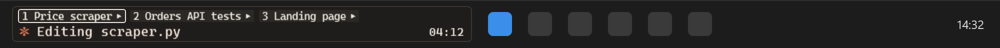

</div>

You send Claude a long prompt, switch to another app, and then keep coming back to check whether it has finished. TaskbarLed puts the answer in the empty left side of the taskbar. It **appears only while Claude is out of sight**, shows every running conversation, and blinks when one of them is done or needs you.

## What it looks like

It wears the colors of the Claude Code terminal by default: cream text on warm charcoal, with a terracotta `✻` that pulses while Claude works. Each conversation gets a tab. The feed below drops in each new action from the top and types it out, like the Claude chat.

| | |
|---|---|
| **Working.** The lit tab is the one in the feed. You see the current action and how long the prompt has been running. |  |
| **Needs you.** A permission request or a question turns the tab and the feed gold, blinking, and that session jumps to the front. | 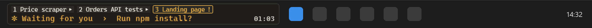 |
| **Done.** The tab shows `✓` and the panel blinks green **until you open the session's app** (Claude or VS Code), with the duration and Claude's last reply. | 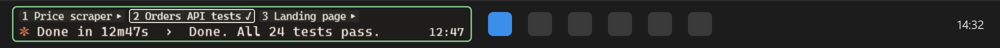 |

### Watching a video in full screen?

Windows silences notifications in full screen. TaskbarLed draws a thin glowing line on the screen edge instead, plus a 4-second alert in the corner, only when something finishes or needs you. Clicking the alert opens Claude.


You can switch to a click-through mini panel, alerts only, or nothing at all. Exclusive full-screen games are never covered.

## Features

- **Shows up only when useful.** Hidden while you can see the app each session runs in, including side by side with another app. Shown when it is minimized, covered or on another virtual desktop. A session in VS Code follows its VS Code window, so opening the Claude app does not hide it.
- **Many sessions, one glance.** Numbered tabs named after each chat's title (the one in Claude's chat list; the folder name when there is none), with status marks you can read without color: `▸` running, `✓` done, `!` waiting.
- **Live details.** Current action (editing a file, running a command, searching), the last reply and the prompt timer.
- **Place it your way.** On the taskbar, floating just above it, or anywhere on screen with edge snapping. Each placement remembers its own spot.
- **A short sound when it matters.** Two rising notes when a session finishes, the same note twice when one needs you, even over a full-screen video. Only while that session's app is out of sight. Three voices (chime, retro, bell) that follow the theme, or pick one; each sound can be turned off.
- **Nineteen themes, switched live.** Claude Code by default, plus terminals, retro LCDs, light and dark cards, or [your own](#make-your-own-theme) from a small JSON file.
- **English and Portuguese.** Follows Windows by default, or pick one in the menu.
- **Works everywhere Claude Code runs.** Desktop app, CLI and IDE extensions (VS Code, JetBrains) share the same hooks.
- **Light and private.** Event driven, about 60 MB of RAM, and nothing ever leaves your machine.

## Themes

Right-click the panel → **Theme**. The panel stays on screen while the menu is open, so you see each theme as you pick it.

| | |
|---|---|
| 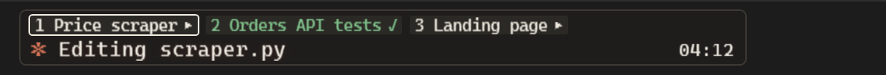<br>**Claude Code**: warm terminal in the spirit of Claude Code, with a pulsing ✻ while it works. The default | 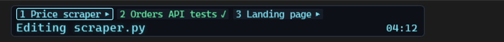<br>**Modern Terminal**: ink-blue dark terminal with smooth cyan text |
| 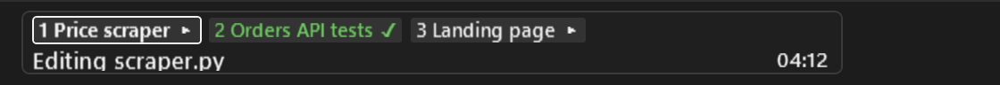<br>**Minimal**: clean dark card | 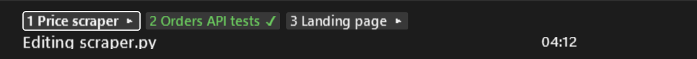<br>**Glass**: no box; text floats on the taskbar |
| 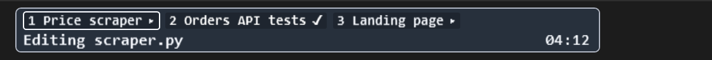<br>**Liquid Glass**: translucent smoked card (native glass on macOS 26) | 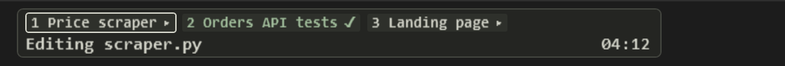<br>**Compact Charcoal**: dark charcoal with soft green accents |
| 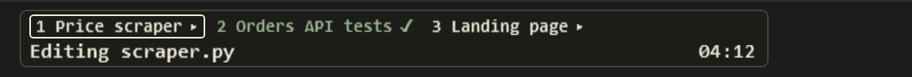<br>**Amber Tree**: dark card with amber accents | 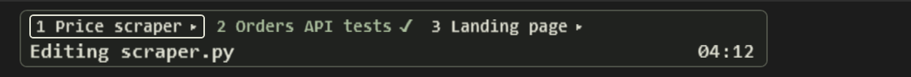<br>**Amber Rail**: dark card with an amber rail |
| 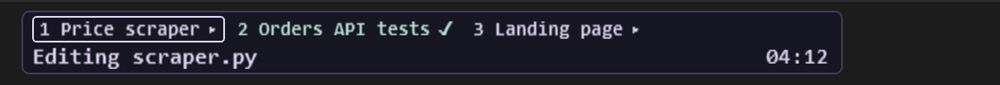<br>**Violet Phosphor**: deep violet with mint text | 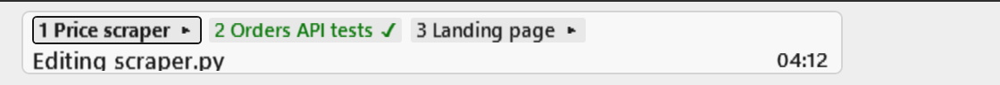<br>**Paper**: light, for a light taskbar |
| 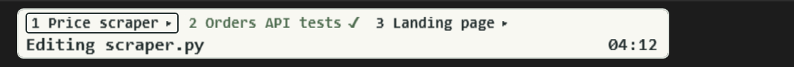<br>**Clear List**: light card with a green accent | 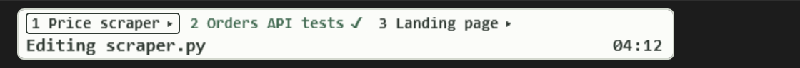<br>**Line Map**: light card in transit-map colors |
| 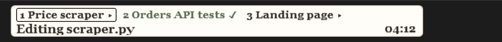<br>**Editorial Index**: cream paper with a serif font | 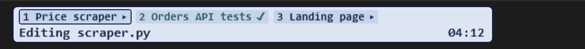<br>**Cobalt Window**: pale blue card with a cobalt frame |
| 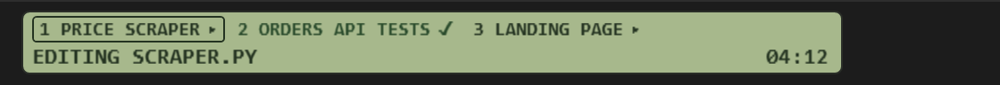<br>**Olive LCD**: olive pocket-calculator screen | 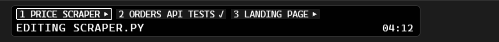<br>**Mono**: black-and-white terminal |
| 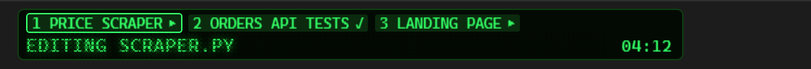<br>**Matrix**: green LED terminal, TaskbarLed's first look |  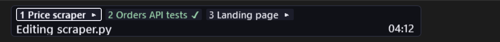<br>**Octo**: dark panel with pink status accents |

The 19 built-in themes are shared by Windows and macOS, including Octo, Line Map and Crystal Liquid. Both panels can show sessions and subagents in rows with elapsed time. On Windows, toggle **Session list** to switch between the floating list and the compact taskbar ticker. **Background opacity** controls the panel surface. **Top activity bar** is a compact, centered alternative. Click it to expand or collapse the sessions. The Windows hook accepts Claude Code and provider-neutral events. See the [theme gallery](docs/MACOS-THEMES.md) for more captures.

| Windows (WPF) | macOS |
| --- | --- |
| 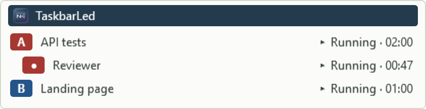 | 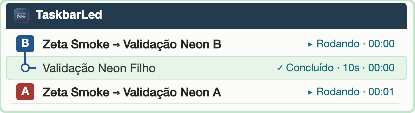 |

### Make your own theme

No coding or rebuilding needed: a theme is a small JSON file.

1. Right-click the panel → **Theme** → **Your own themes…**. This opens `%APPDATA%\TaskbarLed\themes` and puts an example there, `ocean.json`.
2. Copy it, rename it and change the values. Save.
3. Open the menu again: your theme is listed under the built-in ones. Edits to the theme in use show up the next time you open the menu.

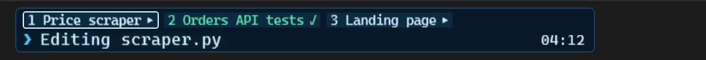

Every field except `name` is optional. Anything left out keeps the Claude Code theme. Colors are `"#RRGGBB"`, or `"#AARRGGBB"` with transparency.

| Field | What it sets |
|---|---|
| `name` | Name in the menu (required, up to 40 characters) |
| `background`, `border` | Panel background and outline |
| `foreground` | Main text and running tabs |
| `dim` | Secondary text (idle tabs) |
| `attention` | "Waiting for you": make it stand out from `foreground` |
| `done` | Finished tabs, the green blink and the edge glow |
| `tabBackground` | Background of tabs that are not selected |
| `edit` | Edit-mode outline |
| `accent`, `feedPrefix` | Color and glyph before the feed line (up to 2 characters, `""` for none). The glyph pulses while Claude works |
| `glow`, `glowStrength` | Text glow color and strength from 0 to 1 |
| `font` | Installed font names, separated by commas |
| `uppercase` | `true` for capitals |

The full example is [docs/themes/ocean.json](docs/themes/ocean.json).

**Safe to share.** A theme file holds values only. TaskbarLed never loads XAML or code from it, and fonts must be names, not paths or network locations. A file that is invalid, larger than 16 KB or breaks a rule is skipped. The reason is written to the log (`%LOCALAPPDATA%\TaskbarLed\taskbarled.log`). The LED dot effect is reserved for built-in themes.

Want a theme to ship with TaskbarLed for everyone? See [Create a theme](CONTRIBUTING.md#create-a-theme).

## Install

**Requirements:** Windows 10 or 11 (x64) and the [.NET 10 Desktop Runtime](https://dotnet.microsoft.com/download/dotnet/10.0).

### Download

1. Get `TaskbarLed-win-x64.zip` from the [latest release](https://github.com/llorenzojorge/TaskbarLed/releases/latest).
2. Extract it to a permanent folder, for example `%LOCALAPPDATA%\Programs\TaskbarLed`.
3. Run `TaskbarLed.exe`.

### Build from source

```powershell
git clone https://github.com/llorenzojorge/TaskbarLed.git
cd TaskbarLed
dotnet publish src/TaskbarLed.App -c Release -o "$env:LOCALAPPDATA\Programs\TaskbarLed"
& "$env:LOCALAPPDATA\Programs\TaskbarLed\TaskbarLed.exe"
```

### First run

TaskbarLed asks before connecting to Claude Code. It adds its hooks to `~/.claude/settings.json`, keeps your existing hooks and settings, and saves a backup next to the file. It also starts with Windows. Both can be turned off from the menu.

## macOS (preview)

The unsigned preview requires macOS 14 or later and supports Apple Silicon and Intel. It shows agent sessions and subagents in a floating panel above the Dock. [macOS guide](docs/MACOS.md) · [Theme gallery](docs/MACOS-THEMES.md)

## Using it

| To… | Do this |
|---|---|
| Open a session | Click its tab: its VS Code window or Claude comes to the front |
| Open what finished | Click the feed line, an alert or the tray icon: a finished session first, else the one in the feed |
| See the next session | Scroll over the panel |
| Open the menu | Right-click the panel or the tray icon |
| Move or resize | Menu → **Edit position and size**. Drag to move, drag the right edge to resize, arrow keys for 1 px steps (Shift for 10 px). Finish with the **Save** or **Cancel** button on the panel, or Enter / Esc |
| Change where it sits | Menu → **Position**: on the taskbar, above the taskbar, or anywhere |
| Change full-screen behavior | Menu → **In full screen** |
| Change or mute the sounds | Menu → **Sound**. Each click plays what you picked |
| Change language | Menu → **Language · Idioma** |

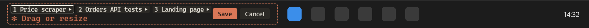

Settings are stored in `%APPDATA%\TaskbarLed\settings.json` and the log in `%LOCALAPPDATA%\TaskbarLed\taskbarled.log`.

### Uninstall

1. Menu → **Disconnect from Claude Code**, and untick **Start with Windows**. Or run `TaskbarLed.exe --uninstall-hooks`.
2. Exit (menu → **Exit**, or `TaskbarLed.exe --exit`), then delete the install folder, `%APPDATA%\TaskbarLed` and `%LOCALAPPDATA%\TaskbarLed`.

## How it works

```
Claude Code hook ──stdin──▶ TaskbarLed.Hook.exe ──named pipe──▶ TaskbarLed.exe ──▶ panel, edge glow, alerts
                                   │ (app closed?)                     ▲
                                   └──▶ spool folder ──── on start ────┘
```

- **Hook bridge.** A tiny executable the Claude Code hooks call. It forwards the raw event in about 65 ms, never prints, and always exits 0, so it can never slow down or break Claude.
- **Translation.** All Claude Code knowledge lives in one class (`ClaudeCodeSource`), covered by tests. Chat titles come from the tail of the conversation transcript.
- **Visibility.** The app walks the window z-order to measure how much of the Claude window you can actually see, and checks for full-screen apps on each monitor.

Read [docs/ARCHITECTURE.md](docs/ARCHITECTURE.md) for the full design.

**Privacy:** TaskbarLed makes no network requests. Events travel over a named pipe that only your Windows user can open. What it reads and writes, and how to report a vulnerability, is in [SECURITY.md](SECURITY.md).

## Limitations

- Plan limits (5-hour and weekly) are not shown yet: the desktop app does not pass them to hooks.
- The reply text updates once per message, not token by token.
- **On the taskbar** placement expects a bottom taskbar (the Windows 11 default). With an auto-hidden taskbar, the panel floats above the screen edge instead.

## Roadmap

- [ ] More agent CLIs (Codex CLI, Gemini CLI, Cursor…) through `ISessionSource`
- [ ] Physical signals: RGB keyboards, LED strips, smart lights
- [ ] Plan usage limits (opt-in)
- [ ] More languages

Ideas and votes are welcome in [Issues](https://github.com/llorenzojorge/TaskbarLed/issues).

## Contributing

Pull requests are welcome. Good first contributions are a new theme, a translation, or support for another agent CLI. Start with [CONTRIBUTING.md](CONTRIBUTING.md).

## License

[MIT](LICENSE). TaskbarLed is an independent project, not affiliated with or endorsed by Anthropic. "Claude" is a trademark of Anthropic.
