<div align="center">

# TaskbarLed

**Um pequeno painel estilo terminal na barra de tarefas do Windows que mostra o que o Claude Code está fazendo. Nunca mais fique na dúvida se o seu prompt já terminou.**

[](https://github.com/llorenzojorge/TaskbarLed/actions/workflows/ci.yml)
[](LICENSE)


[English](README.md) · **Português**

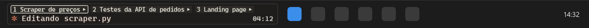

</div>

Você manda um prompt longo para o Claude, vai fazer outra coisa e fica voltando para ver se ele já terminou. O TaskbarLed coloca essa resposta no espaço vazio à esquerda da barra de tarefas. Ele **só aparece quando o Claude está fora de vista**, mostra todas as conversas em andamento e pisca quando alguma termina ou precisa de você.

## Como ele fica

Por padrão ele usa as cores do terminal do Claude Code: texto creme sobre carvão quente, com um `✻` terracota que pulsa enquanto o Claude trabalha. Cada conversa ganha uma aba. O feed embaixo traz cada nova ação de cima para baixo e a digita letra por letra, como o chat do Claude.

| | |
|---|---|
| **Trabalhando.** A aba acesa é a que está no feed. Você vê a ação atual e há quanto tempo o prompt está rodando. |  |
| **Precisa de você.** Um pedido de permissão ou uma pergunta deixa a aba e o feed em dourado piscando, e essa sessão passa na frente das outras. | 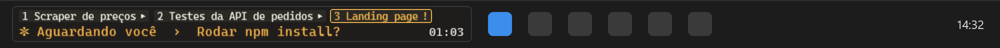 |
| **Pronto.** A aba mostra `✓` e o painel pisca verde **até você abrir o app da sessão** (Claude ou VS Code), com a duração e a última resposta. | 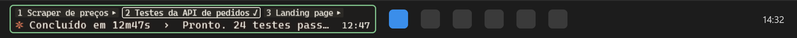 |

### Assistindo um vídeo em tela cheia?

Em tela cheia o Windows silencia as notificações. No lugar delas, o TaskbarLed desenha uma linha luminosa fina na borda da tela e mostra um aviso de 4 segundos no canto, só quando algo termina ou precisa de você. Clicar no aviso abre o Claude.


Também dá pra trocar para um mini painel no canto (os cliques passam para o vídeo), só avisos, ou nada. Jogos em tela cheia exclusiva nunca são cobertos.

## Recursos

- **Aparece só quando é útil.** Some enquanto você vê o app em que cada sessão roda, inclusive em tela dividida com outro app. Aparece quando ele está minimizado, coberto ou em outra área de trabalho virtual. Uma sessão no VS Code segue a janela do VS Code, então abrir o app do Claude não a esconde.
- **Várias sessões num relance.** Abas numeradas com o título do chat (o mesmo da lista de chats do Claude; sem título, o nome da pasta), com símbolos que dá pra ler mesmo sem distinguir cor: `▸` rodando, `✓` concluída, `!` aguardando.
- **Detalhes ao vivo.** Ação atual (editando arquivo, rodando comando, buscando), última resposta e cronômetro do prompt.
- **Do seu jeito.** Na barra de tarefas, flutuando logo acima dela, ou livre em qualquer lugar da tela, com ímã nas bordas. Cada modo lembra a própria posição.
- **Um som curto quando importa.** Duas notas subindo quando uma sessão termina, a mesma nota duas vezes quando uma precisa de você, mesmo por cima de um vídeo em tela cheia. Só enquanto o app daquela sessão está fora de vista. Três timbres (suave, retrô, sino) que acompanham o tema, ou escolha um; cada som pode ser desligado.
- **Sete temas, troca na hora.** Claude Code por padrão, além de visuais de terminal, LED e modernos, ou [o seu próprio](#crie-o-seu-próprio-tema) num pequeno arquivo JSON.
- **Português e inglês.** Segue o idioma do Windows, ou você escolhe no menu.
- **Funciona onde o Claude Code roda.** App desktop, CLI e extensões de IDE (VS Code, JetBrains) usam os mesmos hooks.
- **Leve e privado.** Movido a eventos, cerca de 60 MB de RAM, e nada sai do seu computador.

## Temas

Botão direito no painel → **Tema**. O painel fica na tela enquanto o menu está aberto, então você vê cada tema na hora em que escolhe.

São dois terminais modernos, dois visuais LED retrô e três cartões limpos:

| | |
|---|---|
| 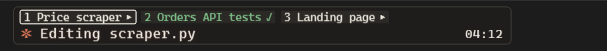<br>**Claude Code**: terminal quente no espírito do Claude Code, com um ✻ que pulsa enquanto ele trabalha. O padrão | 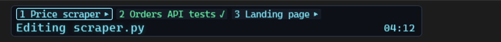<br>**Modern Terminal**: terminal escuro azul-tinta, com texto ciano liso |
| 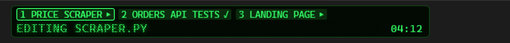<br>**Matrix**: terminal LED verde, o visual original | 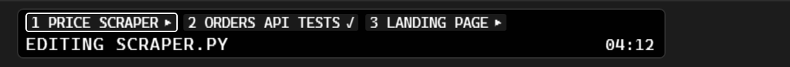<br>**Mono**: terminal preto e branco |
| 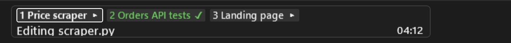<br>**Minimal**: cartão escuro e limpo | 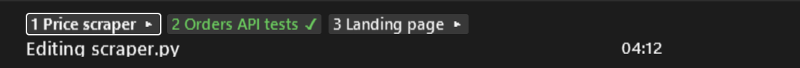<br>**Glass**: sem caixa; o texto flutua sobre a barra |
| 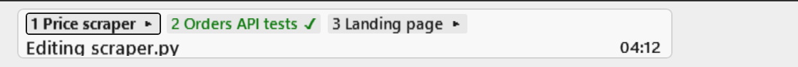<br>**Paper**: claro, para barra de tarefas clara | |

### Crie o seu próprio tema

Sem programar e sem recompilar: um tema é um pequeno arquivo JSON.

1. Botão direito no painel → **Tema** → **Seus próprios temas…**. Isso abre `%APPDATA%\TaskbarLed\themes` e coloca lá um exemplo, `ocean.json`.
2. Copie, renomeie e mude os valores. Salve.
3. Abra o menu de novo: o seu tema aparece abaixo dos que vêm com o app. Edições no tema em uso aparecem na próxima vez que você abrir o menu.

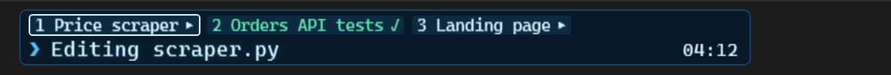

Todos os campos são opcionais, menos `name`. O que ficar de fora usa o valor do tema Claude Code. Cores são `"#RRGGBB"`, ou `"#AARRGGBB"` com transparência.

| Campo | O que muda |
|---|---|
| `name` | Nome no menu (obrigatório, até 40 caracteres) |
| `background`, `border` | Fundo e contorno do painel |
| `foreground` | Texto principal e abas rodando |
| `dim` | Texto secundário (abas paradas) |
| `attention` | "Aguardando você": precisa se destacar do `foreground` |
| `done` | Abas concluídas, o piscar verde e a borda luminosa |
| `tabBackground` | Fundo das abas não selecionadas |
| `edit` | Contorno do modo de edição |
| `accent`, `feedPrefix` | Cor e símbolo antes da linha do feed (até 2 caracteres, `""` para nenhum). O símbolo pulsa enquanto o Claude trabalha |
| `glow`, `glowStrength` | Cor e força do brilho do texto, de 0 a 1 |
| `font` | Nomes de fontes instaladas, separados por vírgula |
| `uppercase` | `true` para letras maiúsculas |

O exemplo completo está em [docs/themes/ocean.json](docs/themes/ocean.json).

**Seguro para compartilhar.** Um arquivo de tema guarda só valores. O TaskbarLed nunca carrega XAML ou código dele, e fontes precisam ser nomes, não caminhos nem endereços de rede. Um arquivo inválido, maior que 16 KB ou fora das regras é ignorado. O motivo fica no log (`%LOCALAPPDATA%\TaskbarLed\taskbarled.log`). O efeito de pontos de LED é exclusivo dos temas que vêm com o app.

Quer que um tema venha com o TaskbarLed para todo mundo? Veja em [Criar um tema](CONTRIBUTING.md#create-a-theme).

## Instalação

**Requisitos:** Windows 10 ou 11 (x64) e o [.NET 10 Desktop Runtime](https://dotnet.microsoft.com/download/dotnet/10.0).

### Baixar pronto

1. Baixe o `TaskbarLed-win-x64.zip` na [versão mais recente](https://github.com/llorenzojorge/TaskbarLed/releases/latest).
2. Extraia numa pasta fixa, por exemplo `%LOCALAPPDATA%\Programs\TaskbarLed`.
3. Abra o `TaskbarLed.exe`.

### Compilar o código

```powershell
git clone https://github.com/llorenzojorge/TaskbarLed.git
cd TaskbarLed
dotnet publish src/TaskbarLed.App -c Release -o "$env:LOCALAPPDATA\Programs\TaskbarLed"
& "$env:LOCALAPPDATA\Programs\TaskbarLed\TaskbarLed.exe"
```

### Primeira execução

O TaskbarLed pede permissão antes de se conectar ao Claude Code. Ele adiciona hooks ao `~/.claude/settings.json`, mantém seus hooks e configurações atuais e salva um backup ao lado do arquivo. Ele também passa a iniciar com o Windows. Os dois podem ser desligados pelo menu.

## Como usar

| Para… | Faça isso |
|---|---|
| Abrir uma sessão | Clique na aba dela: a janela do VS Code dela ou o Claude vem para a frente |
| Abrir o que terminou | Clique na linha do feed, num aviso ou no ícone da bandeja: primeiro uma sessão concluída; se não houver, a que está no feed |
| Ver a próxima sessão | Role a roda do mouse sobre o painel |
| Abrir o menu | Botão direito no painel ou no ícone da bandeja |
| Mover ou redimensionar | Menu → **Editar posição e tamanho**. Arraste para mover e a borda direita para redimensionar. As setas ajustam 1 px (Shift: 10 px). Termine com o botão **Salvar** ou **Cancelar** no próprio painel, ou Enter / Esc |
| Mudar onde ele fica | Menu → **Posição**: na barra, acima da barra ou livre |
| Mudar o comportamento em tela cheia | Menu → **Em tela cheia** |
| Trocar ou silenciar os sons | Menu → **Som**. Cada clique toca o que você escolheu |
| Trocar o idioma | Menu → **Idioma · Language** |

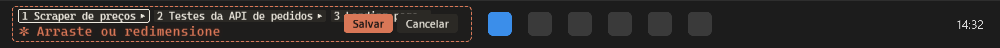

As configurações ficam em `%APPDATA%\TaskbarLed\settings.json` e o log em `%LOCALAPPDATA%\TaskbarLed\taskbarled.log`.

### Desinstalar

1. Menu → **Desconectar do Claude Code** e desmarque **Iniciar com o Windows**. Ou rode `TaskbarLed.exe --uninstall-hooks`.
2. Feche o app (menu → **Sair**, ou `TaskbarLed.exe --exit`) e apague a pasta de instalação, `%APPDATA%\TaskbarLed` e `%LOCALAPPDATA%\TaskbarLed`.

## Como funciona

```
Hook do Claude Code ──stdin──▶ TaskbarLed.Hook.exe ──named pipe──▶ TaskbarLed.exe ──▶ painel, borda, avisos
                                      │ (app fechado?)                     ▲
                                      └──▶ pasta spool ──── ao iniciar ────┘
```

- **Ponte de hook.** Um executável minúsculo que os hooks do Claude Code chamam. Ele repassa o evento bruto em cerca de 65 ms, nunca imprime nada e sempre sai com código 0. Por isso nunca atrasa nem quebra o Claude.
- **Tradução.** Todo o conhecimento sobre o Claude Code fica numa única classe (`ClaudeCodeSource`), coberta por testes. O título de cada chat vem do final do histórico da conversa.
- **Visibilidade.** O app percorre a ordem das janelas para medir quanto da janela do Claude você realmente vê, e verifica se há algo em tela cheia em cada monitor.

O desenho completo está em [docs/ARCHITECTURE.md](docs/ARCHITECTURE.md), em inglês.

**Privacidade:** o TaskbarLed não faz nenhuma requisição de rede. Os eventos trafegam por um named pipe que só o seu usuário do Windows consegue abrir. O que ele lê e grava, e como relatar uma vulnerabilidade, está no [SECURITY.md](SECURITY.md) (em inglês).

## Limitações

- O limite do plano (janela de 5h e semanal) ainda não aparece: o app desktop não repassa esse dado aos hooks.
- O texto da resposta atualiza a cada mensagem, não palavra por palavra.
- O modo **Na barra de tarefas** espera a barra embaixo, que é o padrão do Windows 11. Com a barra em ocultação automática, o painel flutua acima da borda da tela.

## Próximos passos

- [ ] Outros agentes de IA (Codex CLI, Gemini CLI, Cursor…) via `ISessionSource`
- [ ] Sinais físicos: teclados RGB, fitas de LED, lâmpadas inteligentes
- [ ] Limite de uso do plano (opcional)
- [ ] Mais idiomas

Ideias e votos são bem-vindos nas [Issues](https://github.com/llorenzojorge/TaskbarLed/issues).

## Contribuindo

Pull requests são bem-vindos. Boas primeiras contribuições: um tema novo, uma tradução ou suporte a outro agente de IA. Comece pelo [CONTRIBUTING.md](CONTRIBUTING.md).

## Licença

[MIT](LICENSE). O TaskbarLed é um projeto independente, sem vínculo com a Anthropic nem endosso dela. "Claude" é marca registrada da Anthropic.
