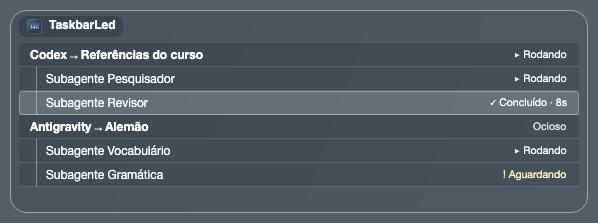
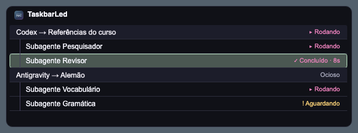

# TaskbarLed themes on macOS

Screenshots of the panel's 19 themes, rendered by TaskbarLed with two sessions and four subagents. Pick a theme from the **Themes** menu in the menu bar.

[Português do Brasil](MACOS-THEMES.pt-BR.md) · [Install on Mac](MACOS.md) · [Back to the README](../README.md)

## Shared themes

| Crystal Liquid |
| --- |
|  |

| Line Map | Liquid Glass |
| --- | --- |
|  |  |

| Editorial Index | Cobalt Window |
| --- | --- |
|  |  |

| Violet Phosphor | Olive LCD |
| --- | --- |
|  |  |

| Amber Tree | Compact Charcoal |
| --- | --- |
|  |  |

| Amber Rail | Clear List |
| --- | --- |
|  |  |

The gallery screenshot shows the panel's gradient. On macOS 26, the native AppKit glass lets the color behind the window show through. A finished row gets a neutral pulse and disappears after ten seconds.

### Position, size and opacity editor

Screenshot of the packaged app on macOS 26.5.2. The finished row uses test data.

## Other included themes

| Claude Code | Modern Terminal |
| --- | --- |
|  |  |

| Matrix | Mono |
| --- | --- |
|  |  |

| Minimal | Glass |
| --- | --- |
|  |  |

| Paper | Octo |
| --- | --- |
|  |  |

## Update the screenshots

From the repository root, run the rendering tests to recreate the images.

~~~sh
TASKBARLED_THEME_GALLERY="$PWD/docs/images/macos-themes" dotnet test tests/TaskbarLed.App.Avalonia.Tests -c Release --filter FullyQualifiedName~ThemeGalleryTests
~~~
